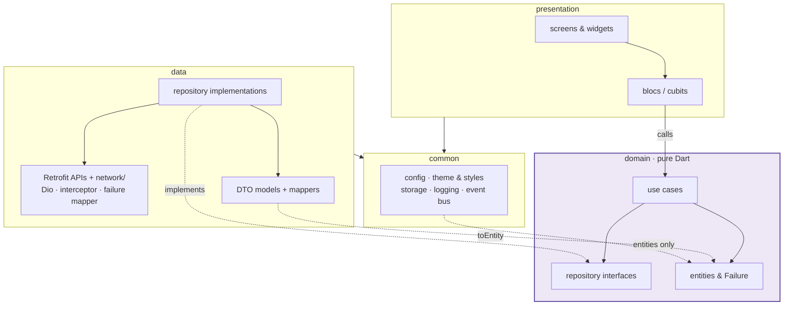
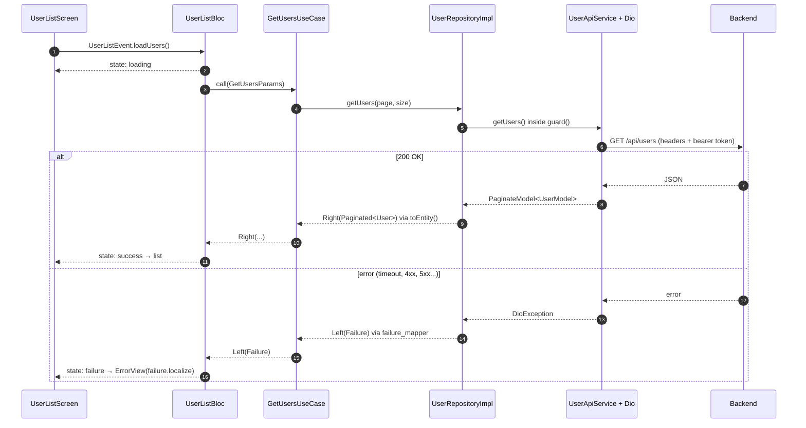
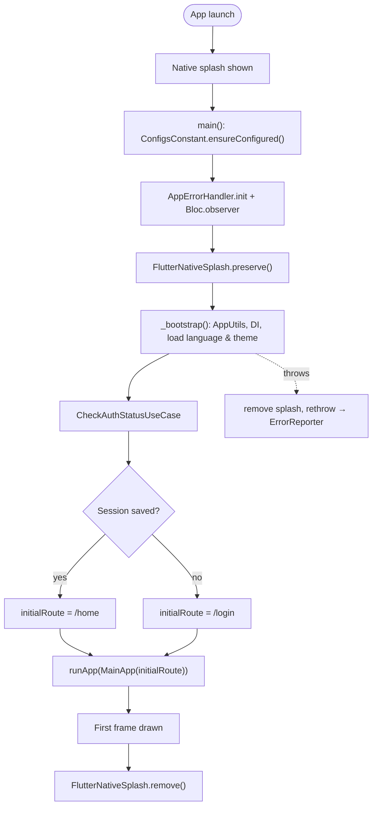
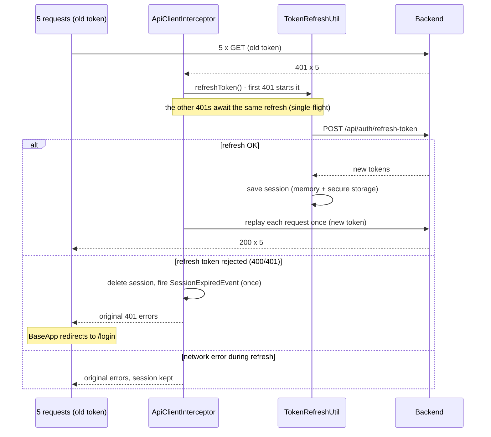

# Flutter BLoC Clean Architecture

[](https://github.com/nkqdev) [](LICENSE)

> Template by [@nkqdev](https://github.com/nkqdev)

Flutter app template built on **Clean Architecture + BLoC**.

- Flutter `3.35.7` (pinned via `.fvmrc`)
- State management: `flutter_bloc`
- DI: `get_it`, wired in a single composition root (`lib/di/`)
- Network: `dio` + `retrofit`, auth interceptor with automatic refresh-token
- Models/State: `freezed` + `json_serializable`
- Error handling: `dartz` `Either<Failure, T>` with a pure-Dart `Failure` sealed class in the domain
- Multi-language: `flutter_localizations` (vi / en)
- Multi-environment: `env/local.json` / `env/uat.json` / `env/production.json` via `--dart-define-from-file`

## What's inside

A small but complete sample app, so every layer has real code to copy from:

| Feature | Screen / route | What it shows |
|---|---|---|
| Startup | native splash → `/login` or `/home` | `preserve`/`remove` splash, session check before the first frame |
| Sign in | `LoginScreen` (`/login`) | form state in a bloc, validation, loading button, localized error SnackBar |
| Sign out / session expiry | `HomeScreen` app bar, `SessionExpiredEvent` | logout use case, global redirect to login when the refresh token is rejected |
| Profile | `HomeScreen` (`/home`) | one-shot load with `UserProfileCubit`, loading / error + retry |
| Settings | `HomeScreen` | dark mode switch (`ThemeBloc`), language vi / en (`LocaleBloc`), both persisted |
| User list | `UserListScreen` (`/users`) | pagination (load more near the end), pull to refresh, empty / error states |

Shared building blocks: `PrimaryButton`, `AppTextField`, `AppLoading`, `ErrorView`, `AppSnackBar` (`lib/presentation/widgets/`), the global styles (`lib/common/theme/global_styles/`) and 35 tests (`test/`).

The API endpoints are examples (`api-*.example.com`): point `env/*.json` to your backend and adapt the request/response models (see *Backend contract* below).

## Folder structure

Project root:

```
.
|-- android/ ios/               # native projects (splash generated by flutter_native_splash)
|-- assets/splash/              # native splash logos (not bundled as Flutter assets)
|-- env/                        # local.json, uat.json, production.json (--dart-define-from-file)
|-- lib/                        # application code (below)
|-- test/                       # architecture, data, domain, presentation, common tests
|-- tool/
|   |-- rename_project.dart     # turn the template into a new project
|-- build.yaml                  # json_serializable options
|-- l10n.yaml                   # localization generation
|-- pubspec.yaml                # dependencies + flutter_native_splash config
```

`lib/`:

```
lib/
|-- assets/                     # images/, icons/ (Flutter assets)
|-- common/                     # Shared, layer-agnostic code
|   |-- constants/              # configs, storage keys, durations
|   |-- dimension/              # Dimension (const design tokens) + AppScale (optional screenutil)
|   |-- enums/
|   |-- services/               # event_bus, logging (AppLogger, ErrorReporter, AppErrorHandler), storage
|   |-- theme/                  # AppTheme, AppColors
|   |   |-- global_styles/      # SizedBoxStyles, EdgeInsetStyles, TextStyles, RadiusStyles, BoxShadowStyles
|   |-- utils/                  # validator, regex, app info
|-- data/
|   |-- api/                    # Retrofit services only
|   |-- network/                # everything HTTP lives here:
|   |   |-- constants/          #   endpoints, headers, api version, request extras
|   |   |-- api_client.dart     #   createDio()
|   |   |-- api_client_interceptor.dart  # token + single-flight refresh
|   |   |-- token_refresh_util.dart
|   |   |-- failure_mapper.dart #   DioException -> Failure
|   |-- models/<feature>/       # DTO (freezed) + request/ + response/ + mappers/
|   |-- repositories/           # base_repository (guard -> Either) + <feature>/*RepositoryImpl
|-- domain/                     # pure Dart, no DI, no Flutter
|   |-- entities/<feature>/
|   |-- failures/               # Failure sealed class (Network, Timeout, Unauthorized...)
|   |-- repositories/<feature>/ # Abstract repositories
|   |-- usecases/               # usecase.dart (UseCase, NoParams) + <feature>/
|-- presentation/
|   |-- blocs/
|   |   |-- status.dart         # BlocStatus: the single state convention
|   |   |-- app_bloc_observer.dart  # logs state changes, reports bloc errors
|   |   |-- <feature>/          # bloc|cubit / event / state (freezed)
|   |-- extensions/             # Failure.localize(l10n)
|   |-- screens/<feature>/      # screen + widgets/
|   |-- widgets/                # shared widgets (button, loading, error...)
|-- routes/                     # route names, route generator, arguments
|-- di/                         # composition root (the only DI code)
|   |-- injection.dart          # ServiceLocator.configureDependencies()
|   |-- modules/                # core, repository, usecase, bloc
|-- l10n/                       # app_en.arb, app_vi.arb
|-- app.dart                    # MainApp(initialRoute)
|-- main.dart                   # preserve splash, bootstrap, runApp
```

### Layers

| Layer | Responsibility | May use | Must not use |
|---|---|---|---|
| `domain` | Business rules: entities, repository **interfaces**, use cases, `Failure` types | `dartz`, `meta`, itself | Flutter, Dio, JSON, storage, any other layer |
| `data` | Talks to the outside world: Retrofit APIs, DTO models, mappers to entities, repository **implementations**, HTTP plumbing (`network/`) | `domain`, `common`, Dio, Retrofit | `presentation`, `routes`, `di`, BLoC |
| `presentation` | UI: screens, widgets, blocs/cubits, turning `Failure` into localized text | `domain` (use cases, entities), `common`, Flutter | `data` (never call an API or a model directly), `di` |
| `common` | Shared helpers with no business meaning: config, design tokens, theme, storage, logging, event bus | `domain` entities only, Flutter | `data`, `presentation`, `routes`, `di` |
| `di`, `routes`, `main.dart` | Wiring: register implementations, build routes, start the app | everything | — |

### Dependency flow



Arrows point to what a layer depends on: **domain is the center and depends on nothing**. `common → domain` is limited to entities (e.g. `AuthStorageService` stores an `AuthSession`). `main.dart`, `di/` and `routes/` (not drawn) wire everything together.

> Diagrams are written in [Mermaid](https://mermaid.js.org): GitHub renders them automatically. In VS Code, install *Markdown Preview Mermaid Support* to see them in the preview.

- **domain** is pure Dart: it only imports `dartz`, `meta` and itself, with no DI code of its own.
- All these rules are enforced by `test/architecture/layer_dependencies_test.dart`: an import that breaks them fails the test suite.
- Errors: **data** maps exceptions to `Failure` (`data/network/failure_mapper.dart`); **presentation** translates them with `failure.localize(l10n)`.
- **data** implements the domain repositories; DTOs → entities through `mappers/`.
- **presentation** calls **use cases** only, never the API directly.

Use cases still receive their repositories through the constructor (DI), but the **registration** into `get_it` lives in the composition root `lib/di/`, not in the domain.

DI is registered in order: `CoreModule` (storage, Dio, Retrofit) → `RepositoryModule` → `UseCaseModule` → `BlocModule`, all in `lib/di/modules/`.

### Request flow (example: loading the user list)



1. **Route & screen** – `AppRouteGenerator` creates `UserListBloc` and adds `UserListEvent.loadUsers()`. In `UserListScreen`, scrolling near the end adds `loadMore()` and pull to refresh adds `refresh()`.
2. **Bloc** – `UserListBloc` emits `status: loading`, then calls `GetUsersUseCase(GetUsersParams(...))`.
3. **Use case** – `GetUsersUseCase` (domain) calls the `UserRepository` interface; it knows nothing about HTTP.
4. **Repository** – `UserRepositoryImpl` (data) calls `UserApiService.getUsers` inside `guard()`.
5. **Network** – Dio + `ApiClientInterceptor` add headers and the bearer token. A `401` triggers one shared token refresh, then the request is replayed.
6. **Mapping** – the JSON becomes `PaginateModel<UserModel>`, then `Paginated<User>` through `toEntity()`. Any exception becomes a `Failure` in `guard()` via `failure_mapper.dart`.
7. **Back to the UI** – the bloc emits `success` with the users, or `failure` with the `Failure`. The screen shows the list, or `ErrorView` with `failure.localize(l10n)` and a retry button.

Every other feature follows the same path; only the names change.

### State convention

Every bloc/cubit uses a freezed state that carries a `BlocStatus` (`initial`, `loading`, `success`, `failure`) plus its own data and an optional `Failure`. Screens branch on `state.status`; there is no second state pattern.

## Startup & splash

The splash is **native only** (`flutter_native_splash`); there is no Flutter splash screen.



1. `main()` calls `FlutterNativeSplash.preserve()`, so the native splash stays up while the app starts.
2. `_bootstrap()` does the real work: `AppUtils`, DI, `LocaleStorageService.load()` and `CheckAuthStatusUseCase`. No artificial delay.
3. The first route is **login** or **home**, passed to `MainApp(initialRoute: ...)`. `onGenerateInitialRoutes` pushes only that route, so there is no page underneath.
4. `BaseApp` calls `FlutterNativeSplash.remove()` after its first frame, when the first screen is already drawn. If startup throws, the splash is removed before the error is rethrown.

Language and theme are preloaded, so `LocaleBloc`/`ThemeBloc` start from the saved values and the first frame never flickers.

**Changing the splash:** replace `assets/splash/splash_logo.png` (384×384, @4x of 96dp) and `assets/splash/splash_logo_android12.png` (1152×1152, logo inside the central 768px circle), adjust colors under `flutter_native_splash:` in `pubspec.yaml`, then run:

```bash
fvm dart run flutter_native_splash:create
```

Only add a Flutter-side loading screen when startup has long, visible work (e.g. device sync on a kiosk). It must then look identical to the native splash (same background and logo position).

## Styles

Import once: `package:flutter_bloc_clean_architecture/common/theme/global_styles/index.dart`.

| Need | Use | Notes |
|---|---|---|
| Gap between widgets | `SizedBoxStyles.verticalMedium`, `SizedBoxStyles.horizontalSmall` | getter, scaled when enabled |
| Padding / margin | `EdgeInsetStyles.allLarge`, `EdgeInsetStyles.scaffold` | getter, scaled when enabled |
| Text | `context.textStyles.h1` … `h6` | from the theme: follows light/dark mode |
| Corners | `RadiusStyles.mediumRadius`, `RadiusStyles.mediumBorder` | `const` |
| Shadow | `BoxShadowStyles.boxShadowBlack` | `const` |
| Icon size, divider | `Dimension.iconMedium`, `Divider()` | divider look comes from `dividerTheme` |

Rules:

- Raw numbers live only in `Dimension` (`const`, design pixels). Screens never write `SizedBox(height: 16)` or `EdgeInsets.all(12)`.
- Spacing and padding styles are **getters**, not `static` fields, so they are recomputed on each build (correct after rotation or resize). Do not cache them in `static final` fields.
- `TextStyles` is a `ThemeExtension`, also mapped onto the Material `TextTheme` (`h1` = `headlineLarge`…). Never hardcode a text color.

### Screen scaling (optional)

Off by default (phone apps). For fixed hardware such as kiosk or POS, set in `env/*.json`:

```json
"ENABLE_SCREEN_SCALING": true,
"DESIGN_WIDTH": 1080,
"DESIGN_HEIGHT": 1920
```

`BaseApp` then wraps the app in `ScreenUtilInit`, and the styles scale through `AppScale.w/h/r/sp`. When off, those calls return the raw value and `ScreenUtilInit` is not used.

## Create a new project from this template

```bash
git clone https://github.com/nkqdev/flutter-bloc-clean-architecture.git my_shop && cd my_shop
rm -rf .git
dart run tool/rename_project.dart --name my_shop --org com.acme --display "My Shop"
fvm flutter clean && fvm flutter pub get
fvm dart run build_runner build --delete-conflicting-outputs
fvm flutter test
git init
```

On GitHub you can also click **Use this template** (when enabled in the repository settings), then clone your new repository and run the same commands from `dart run tool/rename_project.dart`.

`tool/rename_project.dart` changes the Dart package name and every `package:` import, the Android `applicationId`/`namespace` (and moves `MainActivity`), the iOS bundle id, the app name on both platforms, the app title, `APP_CLIENT_ID` and the VS Code launch names. Add `--dry-run` to only list the changes. Then replace the splash logo and `env/*.json` values.

## Getting started

```bash
fvm install
fvm flutter pub get
fvm dart run build_runner build --delete-conflicting-outputs
fvm flutter run --dart-define-from-file=env/local.json
```

Environments: `--dart-define-from-file=env/<local|uat|production>.json` (VS Code has ready-made configs in `.vscode/launch.json`). The app refuses to start when `API_BASE_URL` is missing.

> **Never put secrets in `env/*.json`.** Every value is compiled into the binary and can be extracted. The app is a public OAuth client: it sends `clientId` only, no client secret. The backend must accept that (public client / PKCE).

### Authentication & token refresh

- The session is stored in secure storage and cached in memory, so requests do not read secure storage each time.
- On `401`, `ApiClientInterceptor` runs **one** refresh for all concurrent requests, then replays them. A request that failed with an already-rotated token is replayed without refreshing again.
- Auth endpoints are tagged with `@Extra({RequestExtraConstant.skipAuthRefresh: true})`, so a wrong password never triggers a refresh.
- If the refresh token is rejected (400/401), the session is cleared and `SessionExpiredEvent` sends the user back to login. A network error during refresh keeps the session.



## Backend contract

The sample code assumes this API shape. Adapt the models in `lib/data/models/` and the endpoints in `lib/data/network/constants/api_endpoints_constant.dart` to your backend.

| Call | Request | Response |
|---|---|---|
| `POST /api/auth/login` | `username`, `password`, `grantType`, `clientId` | `accessToken`, `refreshToken`, `tokenType`, `expiresIn` |
| `POST /api/auth/refresh-token` | `grantType`, `refreshToken`, `clientId` | same as login |
| `POST /api/auth/logout` | – | – |
| `GET /api/users` | `PageNumber`, `PageSize`, `Keyword` | `items`, `pageNumber`, `pageSize`, `totalCount` |
| `GET /api/users/{id}` | – | user (same fields as below) |
| `GET /api/users/me` | – | user: `id`, `fullName`, `email`, `phoneNumber`, `avatar`, `createdAt` |
| Errors (4xx/5xx) | – | `message`, `errorCode` or `code` (both optional) |

No client secret is sent: the backend must accept the app as a public client.

## Error handling & logging

- `AppErrorHandler.init()` runs first in `main()`: framework errors (`FlutterError.onError`) and uncaught async errors (`PlatformDispatcher.onError`) go to the `ErrorReporter` as **fatal**.
- `AppBlocObserver` logs every state change (debug builds only) and reports errors thrown inside blocs as **non-fatal**.
- `AppLogger.debug/info` are dropped in release; `warning/error` always go through. Use it instead of `print` or `dart:developer`.
- **Crash reporting:** the default `LogErrorReporter` only logs. To use Crashlytics or Sentry, implement `ErrorReporter` and replace `_errorReporter` in `main.dart`; nothing else changes.
- **Secrets in state:** states are logged with `toString()`. A state holding a secret must hide it, like `AuthState` does (`@Freezed(toStringOverride: false)` + a custom `toString` that masks the password).

## Testing

```bash
fvm flutter test
```

| Folder | What it covers |
|---|---|
| `test/architecture/` | layer dependency rules |
| `test/data/network/` | token refresh (single-flight, auth endpoints, invalid session), `DioException` → `Failure` |
| `test/domain/` | use cases with fake repositories |
| `test/presentation/blocs/` | blocs with `bloc_test` + `mocktail` (login, logout, pagination, double load) |
| `test/presentation/app_start_test.dart` | first route after startup, nothing underneath |
| `test/common/` | styles/theme, error handling |

Mock use cases with `mocktail` (`class _MockX extends Mock implements XUseCase {}`) and test blocs with `blocTest`, asserting the exact sequence of states.

## Adding a new feature (example: `product`)

1. **domain/entities/product/product.dart**: the entity.
2. **domain/repositories/product/product_repository.dart**: the abstract class returning `Either<Failure, T>`.
3. **domain/usecases/product/get_products_usecase.dart**: implements `UseCase<T, Params>`.
4. **data/models/product/product_model.dart** (freezed + json) and **mappers/product_model_mapper.dart** (`toEntity()`).
5. **data/api/product_api_service.dart**: the Retrofit service (endpoints in `data/network/constants/api_endpoints_constant.dart`); register it in `di/modules/core_module.dart`.
6. **data/repositories/product/product_repository_impl.dart**: `extends BaseRepository`, uses `guard()`.
7. Register in `lib/di/modules/`: `RepositoryModule` → `UseCaseModule` → `BlocModule`.
8. **presentation/blocs/product/**: bloc / event / state, with `BlocStatus` in the state; **presentation/screens/product/**: the UI.
9. Add a route in `routes/app_route_names.dart` and `routes/app_route_generator.dart`.
10. Run `build_runner`.
11. Add a `blocTest` for the new bloc in `test/presentation/blocs/`.

## Conventions

- File/folder names: `lowercase_with_underscores`; classes: `PascalCase`; variables/methods: `camelCase`.
- Organize by feature inside each layer.
- Always use `package:flutter_bloc_clean_architecture/...` imports (enforced by the `always_use_package_imports` lint).
- Use `const` and `@immutable` for entities wherever possible.

## Author

Created and maintained by **[@nkqdev](https://github.com/nkqdev)**.
Projects created with `tool/rename_project.dart` keep this credit in their README.

## License

[MIT](LICENSE) © 2026 Quang Nguyen Ky
